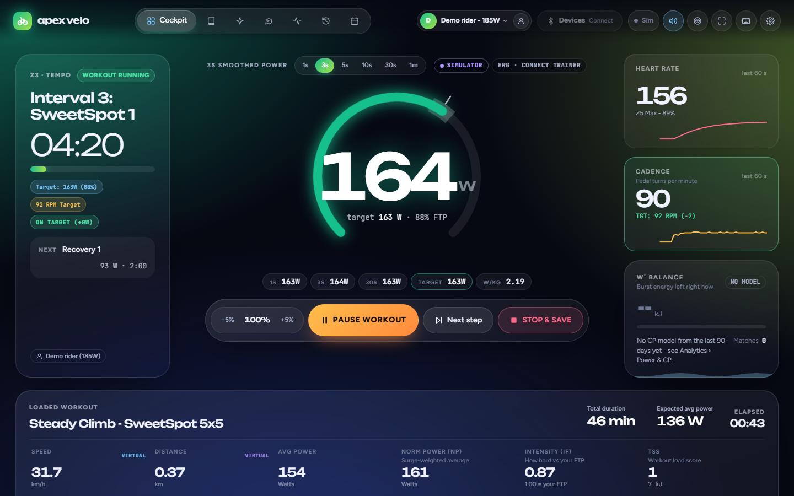
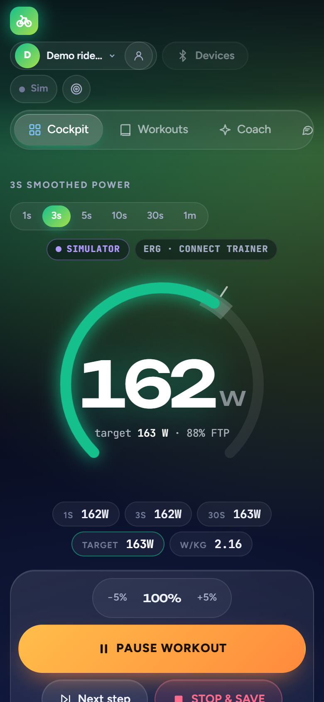
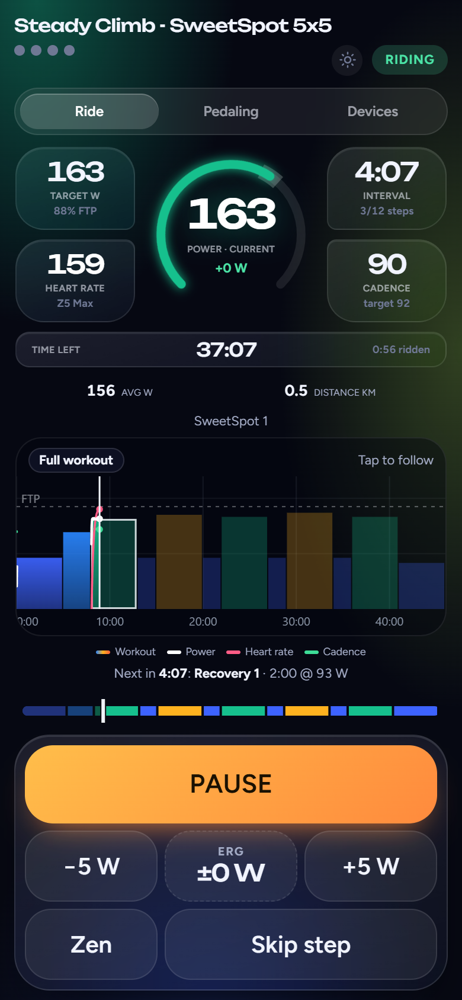
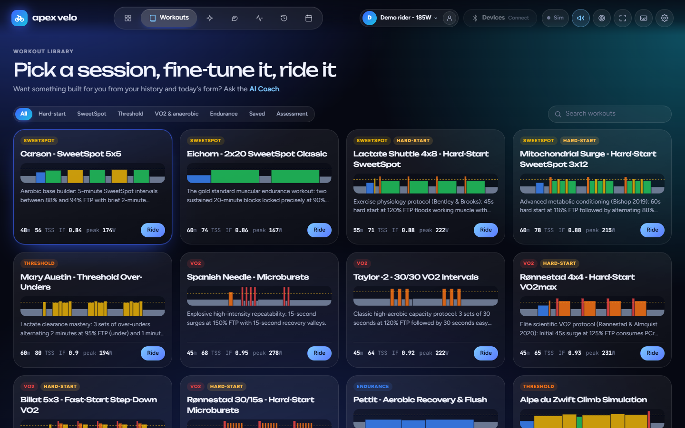
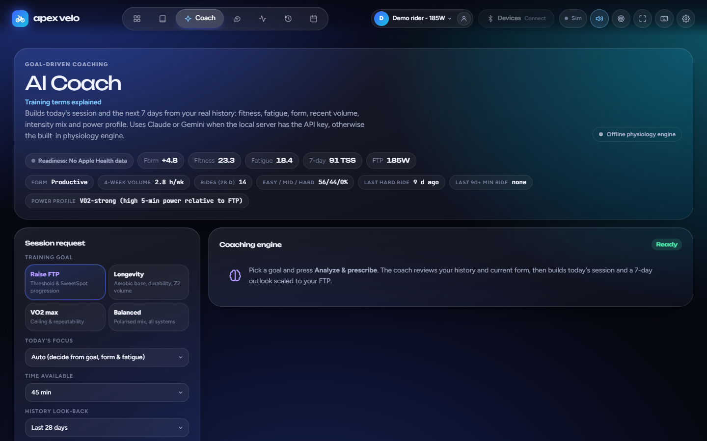
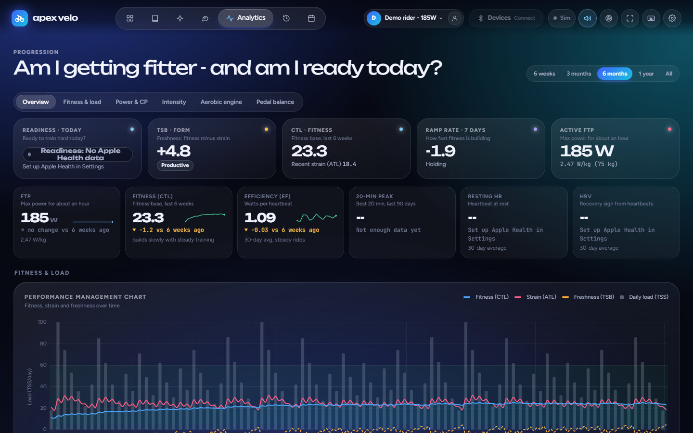
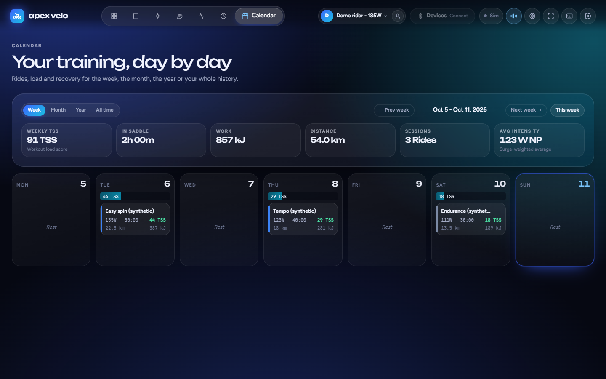

# Apex Velo Lab

An indoor cycling cockpit, AI workout builder and training-analytics dashboard that runs entirely on your own computer. Ride structured ERG workouts with Bluetooth trainers and sensors, import your history, track fitness/fatigue/form, power curves and CP, and (optionally) get workouts and training blocks from Claude, ChatGPT or Gemini.

No account, no cloud service, no subscription. Your rides stay in your browser and on your PC.

**[▶ Watch the trailer on YouTube](https://youtu.be/JPSZ__Zi_GM)**

## Screenshots

*All screenshots use the built-in synthetic demo (**Explore a demo**), not real rider data.*

**Cockpit (desktop)** - a structured ERG workout mid-ride: live power, heart rate, cadence, targets and ride totals


**Phone** - the cockpit on a phone-sized screen, and the phone remote (`live.html`) that follows and controls the ride from another room

<p>
  
  &nbsp;
  
</p>

**Workout library** - SweetSpot, threshold, VO2 and endurance sessions with interval profiles


**AI Coach** - today's session and a 7-day outlook from your fitness, fatigue and form


**Analytics** - readiness, FTP, fitness/fatigue/form (PMC), power curve and CP


**Calendar** - rides, load and recovery by week, month or year


## Requirements

### Minimum (try it out, analyse imported rides)

| | |
|---|---|
| **Computer** | Windows 10/11 (the launcher prepares its runtime automatically), **or** macOS / Linux / Windows with [Node.js 24+](https://nodejs.org) |
| **Browser** | Any current Chrome, Edge, Firefox or Safari |
| **Internet** | To download the app and, on first Windows launch, its runtime if needed. Riding, analytics and the offline coach work offline afterward |
| **Cycling hardware** | None - the built-in simulator and **Explore a demo** work without sensors |

### Recommended for indoor riding

| | |
|---|---|
| **Browser** | Desktop **Chrome or Edge** (Web Bluetooth). Firefox and Safari cannot pair sensors |
| **Bluetooth** | Bluetooth 4.0+ (BLE) in the PC or a USB BLE dongle. ANT+ is not supported |
| **Smart trainer** | Any trainer or smart bike with **Bluetooth FTMS** (e.g. Wahoo KICKR, Tacx/Garmin, Elite, Zwift Hub, Saris, JetBlack) for ERG control. Turn off other apps (Zwift, Wahoo app) so they don't hold the connection |
| **Heart-rate strap** | Any Bluetooth heart-rate strap (standard Heart Rate service) |

### Full functionality (optional extras)

| Feature | What you need |
|---|---|
| **Power meter** | Bluetooth power pedals/crank/hub (Cycling Power Service, e.g. Favero Assioma, Garmin Rally, Stages, 4iiii). Used as the true power source, with left/right balance where reported; PowerMatch trims the trainer to it |
| **Fan control** | Wahoo KICKR HEADWIND (Bluetooth) |
| **Phone remote** | A phone or tablet on the **same home Wi-Fi** as the PC (any modern browser; iPhone Safari works). Shows the ride and controls the workout from another room. On Windows, run `Enable-Phone-View.bat` once |
| **AI coach / Ask** | Internet plus your own API key from Anthropic (Claude), OpenAI (ChatGPT) or Google (Gemini). Usage is billed by the provider. Without a key the offline coach is used |
| **Strava API sync** | Internet, a Strava subscription and your own API application (see [setup](docs/LOCAL-SETUP.md#optional-connections)). File imports can be used without API credentials |
| **Recovery (HRV, resting HR, sleep)** | iPhone with Apple Health and the third-party **Health Auto Export** app (automatic exports need its paid tier), on the same Wi-Fi as the PC |

**Network:** the app is a local server for your PC and your private home network only. Do not port-forward it or expose it to the internet.

## Quick start

1. **Download** - click **Code > Download ZIP** on GitHub (or the latest Release) and extract it, or `git clone` the repository.
2. **Start**
   - **Windows:** double-click **`Launch-Apex-Velo.bat`**. It prepares a verified portable runtime if needed; no manual database setup or `npm install` is required. Keep the window open while you use the app.
   - **macOS / Linux / Node.js:** in the folder, run `node server.js --open` with Node 24+ (no `npm install` needed).

   The app opens at **http://localhost:8080**. Use this address for Web Bluetooth and migration of your existing browser data. Confirmed rides and settings live in SQLite and load in other PC browsers too.
3. **Set up** - choose **Set up my rider** and enter your FTP, weight and max heart rate, or **Explore a demo** to look around with synthetic rides (kept separate from your own data).
4. **Ride** - open **Devices** in the header, choose a device type and **Pair device**. Next time, **Connect saved devices** reconnects everything. Pick a workout and press **Start**.
5. **Bring your history (optional)** - drop FIT, TCX or CSV files from Garmin, Wahoo, Strava, Apple Watch and others into **History > Import**, or connect Strava.

### Optional: AI coach, Strava, phone

The launcher creates a `.env` file in the app folder the first time it runs (from `.env.example`). Edit it, then restart the launcher:

```
ANTHROPIC_API_KEY=      # and/or OPENAI_API_KEY= / GEMINI_API_KEY=
STRAVA_CLIENT_ID=
STRAVA_CLIENT_SECRET=
```

Keys stay on your PC; the browser never sees them. Step-by-step instructions for each connection, the phone remote and Apple Health are in **[local setup and troubleshooting](docs/LOCAL-SETUP.md)**.

### Optional: AI workouts and AI training programs

Everything here is optional. Without an API key the app builds workouts and training blocks with its built-in offline engine, and riding, analytics and Strava work the same. Add a Claude, ChatGPT or Gemini key (above) to let an AI do the planning instead.

- **AI workout creation.** In **AI Coach**, pick a goal (FTP, Longevity, VO2max or Balanced) and a session length (or Auto), optionally type a request such as "45 min over-unders", and load the result into the cockpit in one click. Targets are scaled to your current FTP and zones.
- **AI training programs.** In **AI Coach > Training block**, set a goal, length (4-12 weeks), available days and long-ride day. The AI designs the phases, weekly load and key sessions (and can choose your weekly hours if you leave them blank); the app places them on your Calendar, keeps the load ramp safe, and re-checks the plan after every ride. Suggested changes only apply when you press **Apply**.
- **Evidence-based.** The coach works as a sport scientist from a curated, graded evidence base (e.g. Rønnestad's 30/15s, Seiler's intensity distribution, tapering and strength-training meta-analyses). The AI may cite only those studies, and the offline engine follows the same findings. Each session and block shows **The science behind this**.
- **Personalised from your own history.** The coach sees your fitness/fatigue/form, recent hours and intensity mix, power profile, recent interval diagnosis, power-to-heart-rate drift, new power bests, recovery data and strength sessions when imported. **History look-back** (7-90 days) controls how much is sent.
- **Privacy and cost.** Only compact summaries are sent to the provider you choose, via your local server; keys stay in `.env`. The provider bills API usage, so pick the model and effort that suit your budget.

## Your data

- Rides, settings and profiles live in **SQLite on your PC**: `%LOCALAPPDATA%\ApexVeloLab\apex.sqlite` on Windows, or `~/.local/share/ApexVeloLab/apex.sqlite` on macOS/Linux (honouring `XDG_DATA_HOME`). Existing browser data migrates automatically with a recovery copy.
- Verified compressed **automatic backups** live beside the database in `backups/`, with recent, daily, weekly and monthly copies. **Settings > Backups** can preview and restore them, or open an older backup file. Existing `data/backups` files stay available. Set `APEX_DATA_DIR` for a custom location or `APEX_BACKUP_MIRROR_DIR` for a second backup destination.
- `.env`, Strava tokens and everything in `data/` are git-ignored, so updating never touches them. See [privacy](docs/PRIVACY.md).

## Updating

`git pull` (or extract a new ZIP over the folder, keeping `.env` and `data/`), restart the launcher and press **Ctrl+F5** in the browser.

## Documentation

- [Local setup, connections and troubleshooting](docs/LOCAL-SETUP.md)
- [Full feature reference](docs/FEATURES.md) - cockpit, ERG behaviour, devices, coach, training blocks, Strava sync, phone view, analytics, formulas, architecture
- [Privacy and local data](docs/PRIVACY.md)
- [Maintainer: preparing a release](docs/SHARING.md)
- `tools/` - optional PowerShell helpers to build a ride archive from a HealthFit `.fit` export folder (not needed for normal use)

## Development

`npm test` runs the Node checks with Node 24+. For browser checks: `npm install`, then `npm run test:storage`, `npm run test:browser` and `npm run test:suite`. `npm run check:share` scans the tracked files for secrets and private data before a release. See [development checks](docs/LOCAL-SETUP.md#development-checks) and [SQLite verification](docs/SQLITE-VERIFICATION.md).

## Licence

[MIT](LICENSE). Bundled libraries and fonts keep their own notices in `vendor/`.

## Support development

Apex Velo Lab is free. If it's useful to you, you can [donate via PayPal](https://paypal.me/divanquant) - entirely optional.
