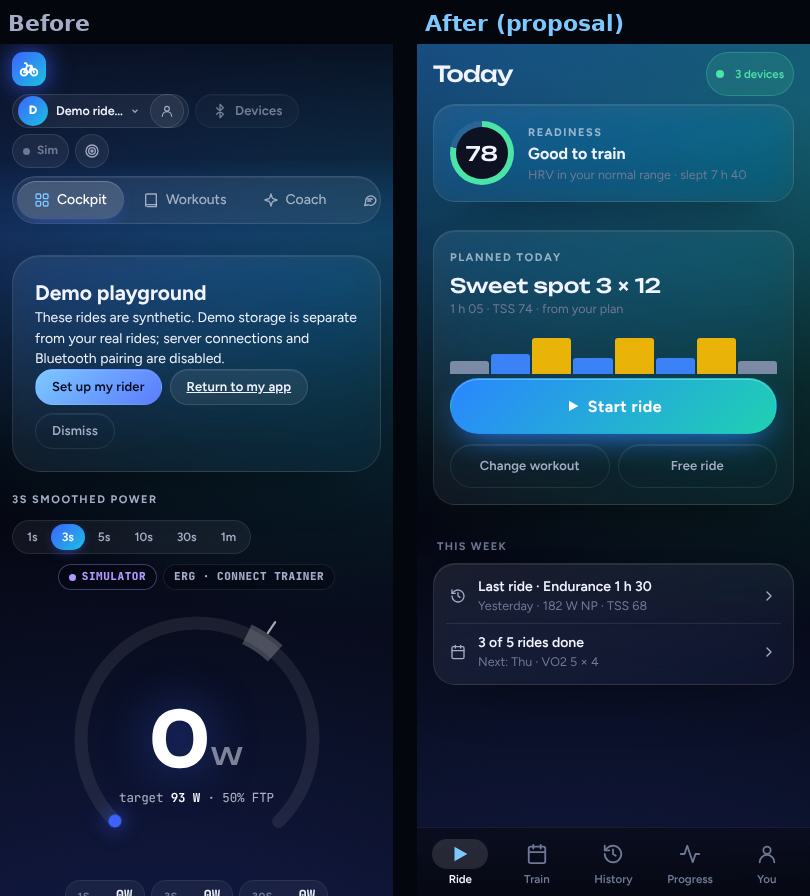
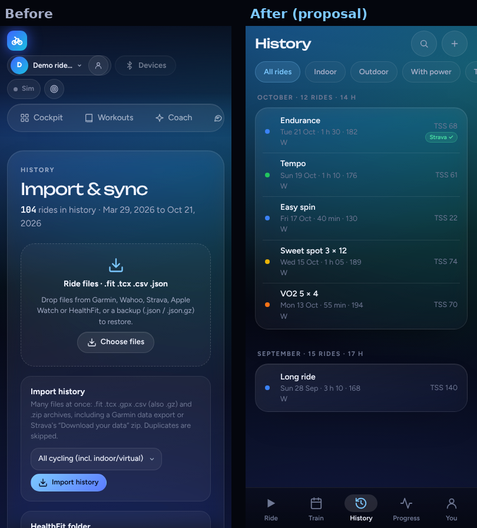
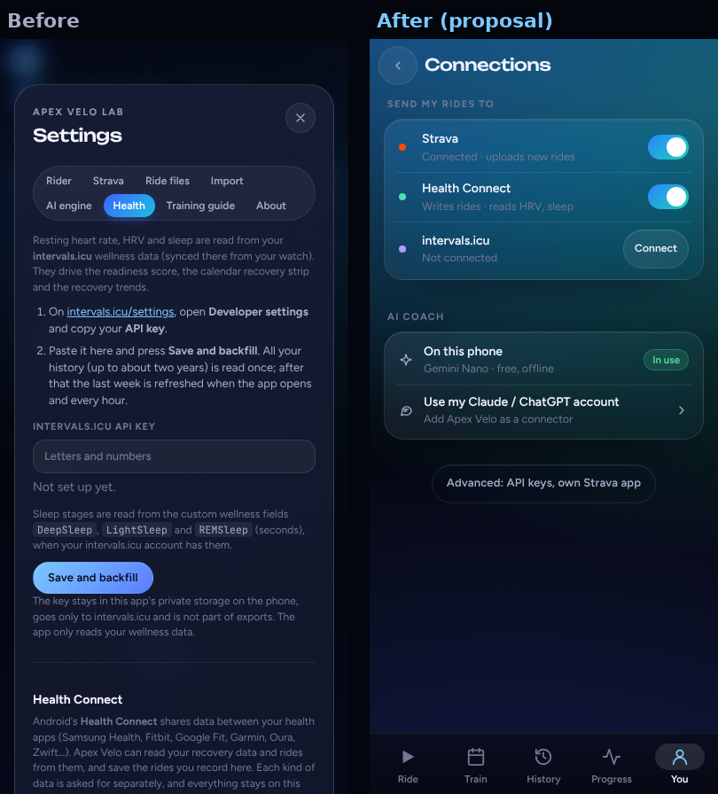

# Apex Velo for Android: phone UX proposal

Status: **proposal for the owner to confirm** (decisions at the end). No app code changes in this PR.

The owner's brief: the look is fine, but the app is hard to use on a phone. Too much happens on each screen, finding
tabs and sections takes too much scrolling, and moving around is hard. Make it simpler and easier to browse without
making it unclear where things live. Keep the visual style.

- Mock-ups: [`docs/ux/mockups.html`](ux/mockups.html). Open it in a browser and click through. On a wide screen a
  phone frame shows with a list of screens beside it. It uses `css/style.css` and `css/fonts.css`, so it looks like the app.
- Screenshots: `docs/ux/before/` (current app), `docs/ux/after/` (mock-ups), and `docs/ux/compare-*.png` (side by side).

| Before → after | |
|---|---|
| First screen |  |
| History |  |
| Settings › Health → You › Connections |  |

---

## 1. Audit

**Method.** Playwright and Chromium at 393×852 (Pixel-like, touch, `isMobile`), on the built mobile web bundle
(`cd mobile && npm run build`, serving `www/`), with `?apexDemo=1` (104 synthetic rides). Settings were captured with
`mobile/tests/fake-native.js` loaded, so the Android layer is active (`.apex-native`): the Strava, Ride files, Import,
Health Connect and About sections appear, and the PC-only items are hidden. Raw numbers are in `docs/ux/before/audit.json`.

### 1.1 Measurements

| Screen | Page length (screens of 852 px) | Visible controls | Controls under 44 px |
|---|---|---|---|
| Cockpit | 4.7 | 79 | 64 |
| Workouts | **19.4** | 166 | 166 |
| Coach | 2.2 | 61 | 55 |
| Ask | 1.8 | 61 | 61 |
| Analytics (Overview panel; 6 more panels) | 3.3 | 74 | 51 |
| Calendar | 2.1 | 50 | 50 |
| History | 2.6 | 373 | 372 |

| Settings section (modal, Android build) | Content height (px) |
|---|---|
| Rider | 720 |
| Strava | 816 |
| Ride files | 363 |
| Import | 467 |
| AI engine | 1101 |
| Health (intervals.icu + Health Connect) | **2512** |
| Training guide | 1464 |
| About | 759 |

- The global header is **189 px tall on every tab** (22 % of the screen). It wraps into four rows: logo; rider picker and
  Devices; Sim and Zen; then the tab capsule.
- The tab capsule scrolls sideways. At 393 px **only Cockpit, Workouts and Coach are visible**. Ask, Analytics, Calendar and
  History are off-screen, and nothing shows they exist.
- On the first screen, **Start workout is at y = 984 px**, below the fold, under the welcome card, the smoothing pills and the gauge.
- On History, the **ride list starts at y = 1219 px**, under three import cards. The list is a wide table
  (Date / Rider / Workout …) that is cut off sideways.
- No page scrolls sideways, which is good. Only inner tables and the tab capsule do.

### 1.2 Feature and setting inventory (Android build, today)

Taps count from app launch. "Swipe" means scrolling the tab capsule sideways. "Scroll" means screens of vertical scrolling.

| Feature | Where it lives today | To reach today | Proposed home | To reach after |
|---|---|---|---|---|
| Start the planned or loaded workout | Cockpit, below the gauge | 1 tap + 1 scroll | Ride › **Start ride** | **1 tap** |
| Pick a workout from the library | Workouts tab (19 screens), then back to Cockpit | 3+ taps + up to 18 scrolls | Train › Workouts (filter chips, short list) | 3 taps (Train, Workouts, workout), 0–1 scroll |
| Describe a workout to AI | Workouts (top) and Coach "More options" | 1–2 taps | Train › Workouts › Describe a workout | 3 taps |
| Connect / pair devices | Header Devices button, a long modal (per-device repeated controls) | 1 tap + scroll | Ride › devices chip (sheet), also You › Devices | 1 tap |
| Calibrate, PowerMatch, rename, fan | Devices modal, per device (repeated 4×) | 1 tap + 1–2 scrolls | Device details (tap a device) | 2 taps |
| Simulator on/off | Header "Sim" pill | 1 tap | You › App settings › Advanced (and offered when no trainer) | 3 taps (rare) |
| Audio cues, Zen | Header icons | 1 tap | Ride screen › ⚙ (during a ride) | 2 taps while riding |
| Smoothing (1s/3s/…), ERG response | Cockpit, always visible | 0–1 scroll | Ride › ⚙ › Show all metrics | 2–3 taps (rare) |
| Today's readiness | Analytics overview card | swipe + 1 tap | Ride (top card) | **0 taps** |
| AI coach plan (week, block) | Coach tab | 1 tap | Train › Plan | 1 tap |
| Calendar | Calendar tab (off-screen) | swipe + 1 tap | Train › Plan (week strip, Month view) | 1–2 taps |
| Ask the AI | Ask tab (off-screen) | swipe + 1 tap | Train › Ask coach, plus "Ask about this ride" in ride detail | 2 taps |
| Last ride details | History (off-screen), scroll past import cards, tap a table row, modal | swipe + 2 taps + 1.5 scrolls | Ride › "Last ride" row, or History › row | **1–2 taps, 0 scroll** |
| Ride list | History table | swipe + 1 tap + 1.5 scrolls | History (grouped by month, cards) | 1 tap |
| Import history | History (top) **and** Settings › Import **and** Settings › Ride files | 2–3 taps | History **+**, which opens You › Your data | 2 taps |
| Export / backups | History (bottom of the log) / Settings | swipe + tap + scrolls | You › Your data | 2 taps |
| Fitness / fatigue / form | Analytics › Fitness & load | swipe + 2 taps | Progress (top card) | 1 tap |
| FTP, power curve, records | Analytics › FTP / Power & CP | swipe + 2 taps + scroll | Progress › Power & FTP | 2 taps |
| Health trends (HRV, sleep, weight) | Analytics › Health (11 cards) | swipe + 2 taps + 3+ scrolls | Progress › Health & recovery | 2 taps |
| Rider profile | Header picker, Settings › Rider, profile modal | 1–2 taps | You (top card) › Edit | 2 taps |
| Switch rider | Header dropdown | 1 tap | You › Switch rider | 2 taps (rare) |
| Strava | Settings › Strava | 2 taps + scroll | You › Connections | 2 taps |
| Health Connect | Settings › Health, below intervals.icu | 2 taps + ~2 scrolls | You › Connections | 2 taps |
| intervals.icu | Settings › Health (top) | 2 taps + scroll | You › Connections | 2 taps |
| AI engine / API keys | Settings › AI engine (1101 px), Ask's engine chip | 2 taps + scroll | You › Connections › AI coach (keys under Advanced) | 2–3 taps |
| Training-load options (strength) | History › "Training load" card | swipe + tap + scroll | You › Your data › Advanced | 3 taps |
| Training guide / glossary | Settings › Training guide, Coach "Training terms explained" | 2 taps | You › Help, plus inline "?" on terms | 2 taps |
| About, licences, privacy | Settings › About | 2 taps | You › Help | 2 taps |

### 1.3 Problems

1. **Navigation is hidden.** Seven top-level tabs sit in a sideways-scrolling capsule at the top of the screen. Four are
   off-screen, and all are out of thumb reach. There is no bottom bar.
2. **The header eats the screen.** At 189 px, it repeats on every tab and mixes global, ride-only and desktop-only
   controls: rider picker, Devices, Sim, Zen, audio and settings.
3. **Pages are too long.** Workouts is 19 screens, and Cockpit is nearly 5 with the Start button below the fold.
   Analytics has a range bar, seven sub-panels and up to 11 cards per panel. History puts import tools above the rides.
4. **Controls overlap or repeat:**
   - Coach, Ask and Calendar are three places for planning and AI.
   - Import appears in History, Settings › Import and Settings › Ride files.
   - Devices appear both as header badges and in a Devices modal.
   - The AI engine can be reached from Ask's chip and from Settings.
   - The glossary is in Settings and in Coach.
5. **Settings is a modal with 8 pill tabs on two rows.** It mixes configuration with help (Training guide, About). The
   Health section is 2512 px because two unrelated services are stacked in it. Strava, Health Connect, intervals.icu and
   AI are all "connections" but sit in three sections.
6. **Too much jargon up front:** Cockpit, ERG response, W′bal, CTL/ATL/TSB, IF, EF, Pw:HR decoupling, Baevsky SI,
   CP model, PowerMatch, "Zero-offset calibrate" and "Sim". Desktop wording leaks into the phone app: keyboard hints like
   "(H)" and "(Z)", "HealthFit folder… on this PC", "Merge local archive".
7. **The main action on each screen is unclear.** The first screen leads with a welcome card and smoothing pills.
   History leads with import. Analytics leads with a range picker.
8. **Touch targets are too small.** 80–100 % of the controls on every tab are under 44 px: icon buttons are 38 px,
   `icon-btn-sm` 28 px, `btn-sm` 30 px, `btn-xs` 24 px, and table rows and pills are small too.
9. **History's ride log is a desktop table:** 373 controls, columns cut off, sort headers as tap targets.

---

## 2. Proposal

### 2.1 Information architecture: five bottom tabs

```
┌──────────────────────────────────────────────────────────────┐
│  Ride        Train          History        Progress    You    │
│  (today)     Plan           ride list      overview    profile│
│              Workouts       ride detail    › Fitness   devices│
│              Ask coach                     › Power/FTP connect│
│                                            › Intensity data   │
│                                            › Health    app    │
│                                            › Records   help   │
└──────────────────────────────────────────────────────────────┘
```

| Tab | Rider's question | Contains (from today's app) | Primary action |
|---|---|---|---|
| **Ride** | "What do I do today, and go." | Readiness card, today's planned workout, device status, last ride and week summary. Starting opens the full-screen **ride screen** (today's Zen cockpit as the phone default). | **Start ride** |
| **Train** | "What's my plan, and what else could I ride?" | One segmented control: **Plan** (Coach + Calendar: week strip, block, re-plan), **Workouts** (library with filter chips, Describe a workout), **Ask coach** (today's Ask). | **Ride it today** (Plan) / pick a workout (Workouts) / ask (Ask coach) |
| **History** | "What did I ride?" | Ride list grouped by month, with filters and search. Ride detail with an inline coach take, sync status and "Ask about this ride". **+** to import. | Open a ride |
| **Progress** | "Am I getting fitter? Am I healthy?" | Today's Analytics. A one-card answer (fitness, fatigue, form), then five rows that open detail pages: Fitness & load, Power & FTP, Intensity, Health & recovery, Records. One range chip in the top bar. | Open a topic. On Power & FTP, **Update FTP** when an estimate is ready. |
| **You** | "Me, my gear, my accounts." | Profile, Devices, Connections, Your data, App settings, Help. It replaces the Settings modal, the header rider picker and the profile modal. | Edit profile |

**Why these five.** They follow what riders do, in the order they do it: ride today, plan, look back, check the trend,
and adjust the setup. It is also the pattern riders already know from Strava, TrainerRoad and Zwift Companion. Five fits
393 px at about 78 px per tab with labels. Each of today's seven tabs maps to exactly one place:

- Cockpit → Ride
- Workouts, Coach, Calendar and Ask → Train
- History → History
- Analytics → Progress
- Settings → You

AI moves into the screens it serves (Plan, Ask coach, the ride detail's coach take) instead of having its own tabs.

**Global rules:**

- **No global header.** Each screen has a 56 px top bar with its title and at most two 44 px actions.
  - Ride: a device-status chip.
  - History: search and +.
  - Progress: the range chip.
- **The bottom bar is always visible** except during a ride and onboarding. Tapping the active tab again returns to that
  tab's root and scrolls to the top.
- **One level of drill-down**, opening a page with a back arrow, and **sheets** for quick tasks (devices, ride options,
  import). Nothing goes deeper than tab › page › sheet.
- The **ride screen is full-screen**, with large controls: End, Pause or Resume, and Skip, each 64 px tall. Everything
  else is under ⚙ ("During this ride"): audio, intensity ±, ERG or resistance mode, devices, and "Show charts & all
  metrics", which gives today's full cockpit.
- **Android back** follows the same stack: sheet › page › tab root › Ride › exit. During a ride, back asks before ending.

### 2.2 Progressive disclosure

| Screen | Always visible | Behind "More", a sheet or a detail page |
|---|---|---|
| Ride | Readiness, today's workout, Start, Change workout, Free ride, last ride | Smoothing, ERG response, simulator, W′bal, L/R, live graph (the ride screen's ⚙ › Show all metrics) |
| Ride screen | Power vs target, interval and time left, HR, cadence, elapsed, End/Pause/Skip | Audio, intensity ±, mode, devices, charts |
| Train › Plan | Week strip, today's or next session, block summary, Re-plan | Month view, block editor, "The science behind this" |
| Train › Workouts | Category chips, list (name, duration, TSS) | Workout editor, save, assessments |
| History | Month groups, ride rows (name, date, duration, NP, TSS, synced tick) | Search, filters, bulk actions |
| Ride detail | 6 KPIs, chart, coach take, sync status | Zones, laps, best efforts; More: edit, export FIT, delete |
| Progress | One answer card + 5 topic rows | Each topic page; tables under "More" (CP model, L/R balance, supporting calculations) |
| You › Connections | Each service: one row, one switch or Connect | Advanced: API keys, own Strava app, broker details |
| You › Your data | Import rides, Watch a folder, Back up, Export | Advanced: training-load options, Replace or Clear history |

Jargon rule: the first view of each screen uses plain words ("Fitness", "Fatigue", "Form", "Good to train"). Expert terms
(CTL/ATL/TSB, IF, EF, W′bal, CP) stay on the detail pages, each with an inline "?" that opens its glossary entry
(`js/velo-glossary.js` already has these).

### 2.3 Simplified Settings ("You")

Today there are 8 modal sections. The proposal has 6 rows, each opening one short page.

| New page | Contents | Moved from |
|---|---|---|
| **Profile** | Name, weight, FTP, max HR, zones; switch, add or delete a rider | Settings › Rider, profile modal, header picker |
| **Devices** | Paired list with status; Pair a new device; per-device details (calibrate, PowerMatch, rename, replace, forget); fan | Header Devices modal and badges |
| **Connections** | *Send my rides to:* Strava, Health Connect, intervals.icu. *Recovery data from:* Health Connect / intervals.icu. *AI coach:* on this phone, your Claude/ChatGPT account (MCP). *Advanced:* API keys, own Strava app | Settings › Strava, Health, AI engine |
| **Your data** | Import rides (files, zip), Watch a folder, Back up, Export; *Advanced:* training-load options, replace or clear history | Settings › Ride files, Import; History's import, export and training-load cards |
| **App settings** | Units, audio cues, keep screen on, ride-screen metrics; *Advanced:* simulator | Header Sim, audio and Zen |
| **Help** | Training guide (glossary), About, licences, privacy | Settings › Training guide, About |

Each service row shows its state in words ("Connected · uploads new rides") and has a single switch or Connect button. Long setup
instructions (intervals.icu API key steps, Health Connect permissions) move to that service's own page and are no longer
stacked on one screen.

### 2.4 First-run onboarding

It runs on first launch, when `needsSetup` is set (it replaces today's welcome card). It has three steps with a progress bar, and **every step can be
skipped**. Anything skipped can be done later from You.

1. **About you**: name, weight, FTP (default 200), and max HR (optional). One line explains that a ramp test can set FTP later.
2. **Pair your devices**: a live scan list using the existing chooser (`native-ble.js`), with tips for waking each device.
   Skipping leaves the simulator on.
3. **Connect (optional)**: Strava (upload only), Health Connect (permissions), and Import my history (opens the
   import picker; the job runs in the background). A note says that everything stays on the phone unless the rider connects it.

It ends on **Ride** with **Start ride** as the next step. "Explore a demo" stays as a link on step 1 for people who want to look around first.

### 2.5 Desktop: keep the current layout (recommended)

**Recommendation: keep the desktop layout as it is, and turn on the new shell only in the Android app (`.apex-native`).**

- Lower risk. The desktop app is used at the trainer with a keyboard and a large screen, where the top tab capsule
  works. Root `index.html`, `js/` and the desktop tests stay unchanged (roadmap principle 4).
- The shell **moves existing DOM nodes** (`#view-*` sections, cards, modals) into the new destinations at start-up instead
  of copying them. All the existing ids and `js/app*.js` bindings keep working. New phone-only parts (Today, the
  ride-list cards, the You pages, onboarding) are built in `mobile/src/`.
- Later and optional: the same IA as a desktop left rail, once the phone version has proven itself. It would be a
  separate decision.

---

## 3. Build plan

### Shared contracts (Workstream U1 lands these first; everything else builds on them)

- **Shell API** in `mobile/src/native-shell.js`, exposed as `window.ApexNative.shell`:
  - `registerTab(id, { label, icon, root })`, where the ids are `ride | train | history | progress | you`
  - `go(route)`, with routes such as `ride`, `ride/live`, `train/workouts`, `history/<rideId>`, `progress/power`, `you/connections`
  - `openSheet(el, { title })`, `closeSheet()`, `back()`
  - `onRoute(fn)`
- The route lives in `location.hash`, so a deep link opens the right screen. Android back is wired through `@capacitor/app` `backButton`.
- The shell calls `app.switchTab(...)` when a destination hosts an old view, so existing lazy rendering still runs.
- **Layout primitives** in `mobile/web/apex-shell.css`, using `style.css` tokens only:
  - `.av-topbar`, `.av-tabbar`, `.av-page`, `.av-sheet`
  - `.av-row` (a 56 px list row), `.av-seg` (a 44 px segmented control), `.av-more`
  - `.apex-native` overrides that raise `.btn-sm`, `.btn-xs`, `.icon-btn`, `.chip` and `.cat-pill` to 44 px minimum hit areas, using padding or `::after` so they look the same.
- **Ownership rule:** a workstream edits only its own files. Root `index.html`, `js/` and `css/` are not edited.
  If a screen needs a hook in `js/`, it goes in a small, separate PR reviewed for desktop safety.

### Workstreams

| ID | Workstream | Owns | Depends on |
|---|---|---|---|
| **U1** | Nav shell + Ride | `mobile/src/native-shell.js`, `mobile/web/apex-shell.css`, `mobile/src/native-today.js`, shell wiring in `mobile/src/index.js` and `native-app.js` (hide the old header and tab capsule under `.apex-native`) | none (lands first) |
| **U2** | Train | `mobile/src/native-train.js` (mounts Coach, Calendar, Workouts and Ask views under one segmented control; short workout list with filter chips) | U1 contracts |
| **U3** | History + ride detail | `mobile/src/native-history.js` (month-grouped card list over `app.history`, ride detail page, + → import sheet) | U1 |
| **U4** | Progress | `mobile/src/native-progress.js` (overview card, 5 topic pages that host the existing Analytics panels by `data-panel`, range chip) | U1 |
| **U5** | You + onboarding | `mobile/src/native-you.js`, `mobile/src/native-onboarding.js`. Re-homes Settings sections, profile modal and Devices modal content into pages, and splits Health into two services. Coordinates with roadmap J (onboarding), which it replaces for UI. | U1 |

U2–U5 run in parallel once U1's contracts are merged. Each opens its own PR into `claude/android-apk-poc`.

### Acceptance criteria (every workstream)

- **Taps to reach, measured from launch at 393×852:**

  | Task | Max taps | Max scrolls |
  |---|---|---|
  | Start today's ride | 1 | 0 |
  | Open the device sheet | 1 | 0 |
  | Open the last ride | 2 | 0 |
  | Pick and start a library workout | 4 | 1 |
  | Ask the coach | 2 | 0 |
  | See FTP | 2 | 0 |
  | See HRV trend | 2 | 0 |
  | Connect Strava or Health Connect | 3 | 0 |
  | Import history | 2 | 0 |
  | Edit FTP or weight | 2 | 0 |

- **No horizontal page scroll** on any route: `scrollWidth <= innerWidth`. Chip rows can scroll sideways inside themselves.
- **Touch targets ≥ 44×44 px** for every visible control on the workstream's routes. Inline text links in prose are exempt.
- **Root pages** (each tab's first screen) fit in ≤ 1.5 screens at 393×852. Detail pages have no limit, but their primary action is above the fold.
- **The bottom bar is visible** on every tab route, and hidden on the ride screen and during onboarding. Android back follows the stack.
- **Tests:** extend `mobile/tests/native-browser.cjs`, or add `mobile/tests/phone-ux.cjs` (U1 creates the helper):
  - a Playwright flow per task in the table above at 393×852, `isMobile`, `hasTouch`, with demo data, asserting the tap count and the end screen
  - a sweep over all routes asserting no horizontal scroll and no controls under 44 px
- The existing suites stay green: `npm test` at the root, and `cd mobile && npm test && npm run test:browser`.
- **The desktop is unchanged.** No diff to the root `index.html`, `css/` or `js/` beyond any agreed hook.
- Each PR includes before and after screenshots of its routes in `docs/ux/after/` and updates `mobile/README.md`.

---

## 4. Decisions for the owner

1. **Five bottom tabs: Ride · Train · History · Progress · You.** Coach, Calendar, Workouts and Ask all go into Train.
   Is that grouping right, or should "Coach" (Plan + Ask) be its own tab and Workouts stay separate?
2. **On the phone, the ride screen is the simple full-screen (Zen-style) view by default**, with the full cockpit under
   ⚙ › Show all metrics. Should it go the other way round?
3. **Settings moves into "You"**, with six pages: Profile, Devices, Connections, Your data, App settings, Help.
   Strava, Health Connect, intervals.icu and AI sit together under Connections. Expert options (API keys, simulator,
   training-load options) go under "Advanced".
4. **Desktop keeps its current layout.** The new IA ships only in the Android app for now.
5. **Onboarding has three skippable steps** (profile → devices → connections and import) and replaces the welcome card.
   "Explore a demo" moves to a link on step 1.
